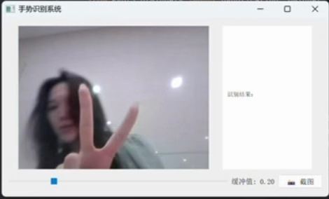
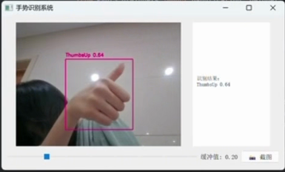
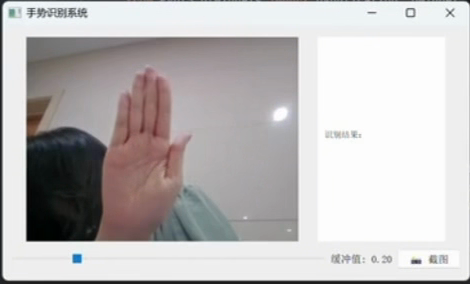
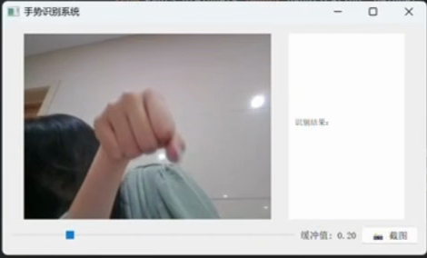
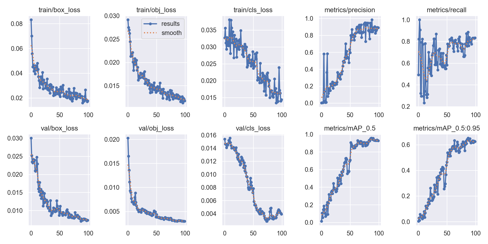

# YuZhang LingMou: Real-Time Hand Gesture Recognition with YOLOv5

A real-time hand gesture recognition system built on [YOLOv5](https://github.com/ultralytics/yolov5) and PyQt5. It captures camera frames, detects gestures, lets you adjust the confidence threshold and saves screenshots. Possible uses include human-computer interaction, smart control and teaching demos. The project also includes a standalone image-processing tool that adjusts contrast, removes noise, sharpens and scales images.

## Features

### Basic image processing (`image_tool.py`)

1. Load and save images
2. Brightness adjustment
3. Contrast adjustment
4. Hue adjustment
5. Scaling
6. Rotation
7. Denoising
8. Sharpening

### Gesture recognition (`gui.py`, `inference_gesture.py`)

- **Real-time detection:** processes camera video streams at 30+ FPS (USB or IP cameras)
- **Supported gestures:**
  ✊ Fist | ✋ OpenPalm | ✌ PeaceSign | 👍 ThumbsUp
- **Adjustable settings:**
  - Dynamic confidence threshold (adjustable from 0.1 to 0.9)
  - Screenshot saving (saved to `./screenshots/`)
- **Model:**
  A lightweight YOLOv5s model trained for 100 epochs on a small 4-class dataset (200 images); validation mAP@0.5 = 0.928 (see [Training Results](#training-results))

## Demo

| Peace Sign | Thumbs Up | Open Palm | Fist |
|---|---|---|---|
|  |  |  |  |

Full demo video: [demo/demo.mp4](demo/demo.mp4) (86 s). On-screen captions are in Chinese; English subtitles: [demo_subtitles_en.srt](demo/demo_subtitles_en.srt) (load it in VLC / any player alongside the video).

| Time | Content |
|---|---|
| 0:00–0:30 | Launching `gui.py` in PyCharm; YOLOv5s model loads (214 layers, 7.0M params) |
| 0:32–0:57 | Detecting Peace Sign → Thumbs Up → Open Palm → Fist |
| 1:00–1:10 | Adjusting the confidence threshold with the slider |
| 1:20–1:26 | Saving a screenshot |

> Note: the GUI labels in the recording are from the original Chinese version (手势识别系统 = Gesture Recognition System, 识别结果 = Results, 缓冲值 = Confidence, 截图 = Screenshot). The code in this repo has since been translated to English.

## Training Results

YOLOv5s, 100 epochs, trained on 160 images and validated on 20 (4 classes). Full per-epoch log: [training/results.csv](training/results.csv).



| Metric (validation) | Final epoch (99) | Best epoch (87) |
|---|---|---|
| mAP@0.5 | **0.928** | 0.958 |
| mAP@0.5:0.95 | 0.624 | 0.651 |
| Precision | 0.892 | 0.842 |
| Recall | 0.833 | 0.886 |

**Observations**
- Training and validation losses decrease together, and the validation loss does not rise, so there is no obvious overfitting within 100 epochs.
- mAP@0.5 jumps around epoch 50. This matches the drop in validation classification loss: the model first learns to localise hands, then learns to tell the gestures apart.
- The gap between mAP@0.5 (0.93) and mAP@0.5:0.95 (0.62) shows that the boxes are not tight at strict IoU thresholds. One likely cause is the 128×128 input resolution of the dataset.
- **Caveat:** the validation set has only 20 images, so these metrics have high variance. A larger and more diverse dataset (different lighting, backgrounds and skin tones) would be needed for a reliable estimate.

## Project Structure

```
├── gui.py                     # PyQt5 desktop app: live detection + slider + screenshot
├── inference_gesture.py       # Lightweight OpenCV-window version (keyboard controls)
├── image_tool.py              # Tkinter image-processing tool
├── training/                  # results.png + per-epoch results.csv
├── YOLOv5-Hand-Gesture.v2i.yolov5pytorch/
│   ├── data.yaml              # Dataset config (4 classes)
│   ├── train/ valid/ test/    # Images + YOLO-format labels
└── yolov5/                    # Cloned YOLOv5 repo (not included)
```

## Installation

**Requirements**

- Python 3.7+
- CUDA 11.3 (recommended for GPU acceleration)

Install the dependencies:

```bash
pip install opencv-python PyQt5 torch torchvision numpy pillow
```

The project depends on the YOLOv5 framework. Clone it into the project root:

```bash
git clone https://github.com/ultralytics/yolov5.git
```

Make sure you have the trained gesture-recognition weights. They should be at the following path, or you can change the path in the code:

```
./yolov5/runs/train/gesture_yolov5s_clean3/weights/best.pt
```

## Training (reproduce the model)

```bash
cd yolov5
python train.py --img 640 --epochs 100 \
    --data ../YOLOv5-Hand-Gesture.v2i.yolov5pytorch/data.yaml \
    --weights yolov5s.pt --name gesture_yolov5s_clean
```

## Quick Start

```bash
python gui.py                 # desktop GUI
python inference_gesture.py   # OpenCV window: 'q' quit, 's' screenshot, ↑/↓ threshold
python image_tool.py          # image-processing tool
```

When the system starts, it opens the camera and shows the live video with recognition results. Use the slider at the bottom to adjust the confidence threshold.

## Dataset

The hand gesture dataset was exported from Roboflow in YOLOv5 PyTorch format. It has 4 classes: Fist, OpenPalm, PeaceSign and ThumbsUp.

## Author
Peiran (Cynthia) Jing · [github.com/pr000000](https://github.com/pr000000)
